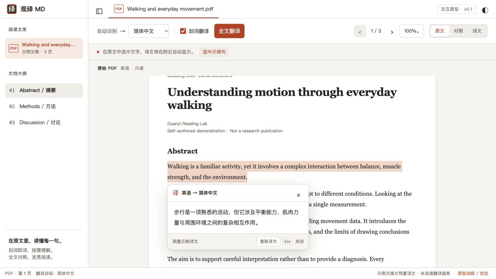
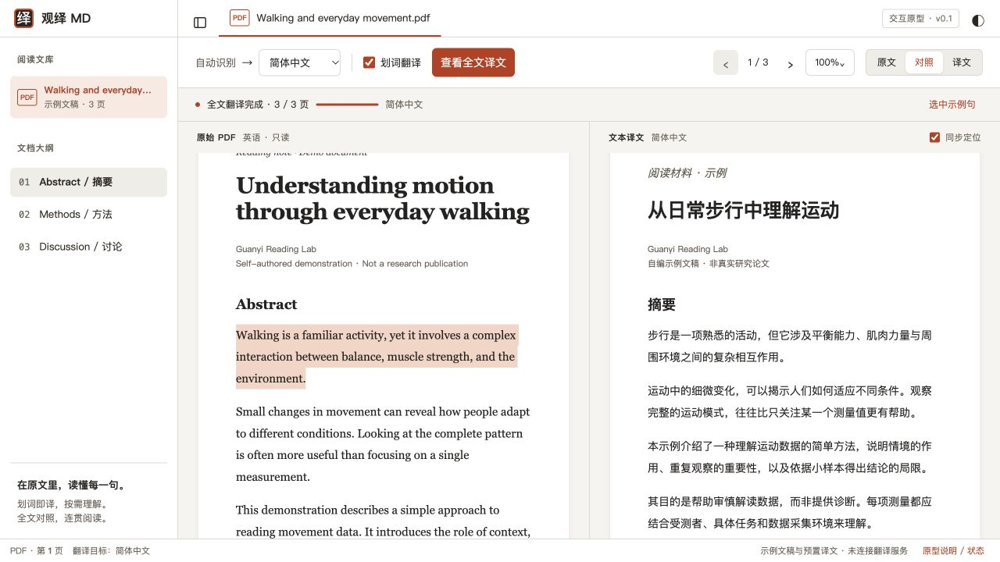
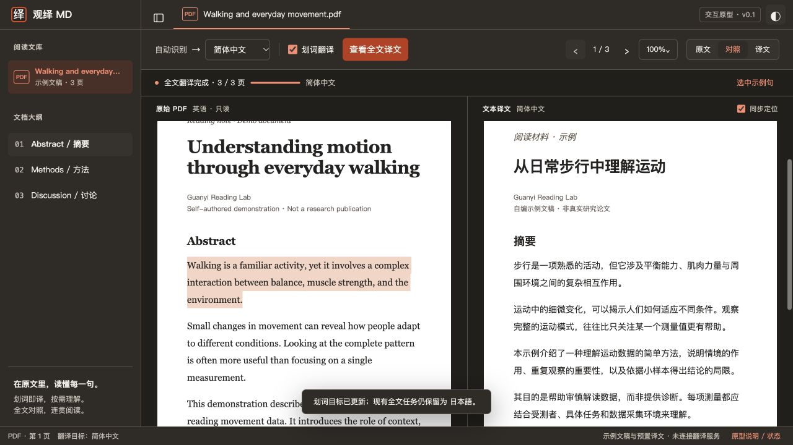
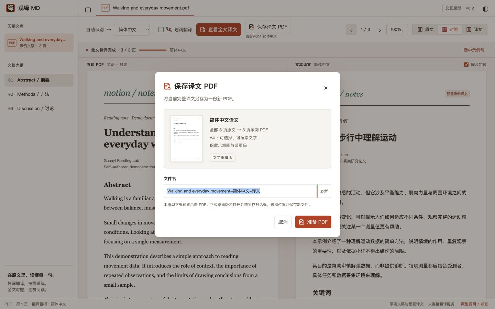

# PDF 翻译原型说明与走查

- 版本：v0.6（专题原型；总原型已合并）
- 日期：2026-11-15
- 阶段：方案与原型，待产品评审。
- [打开交互原型](PDF翻译交互原型.html) · [阅读产品方案](../1%23产品方案/PDF全文翻译与划词翻译方案.md)
- [主页与 AI 对话原型](观译主页与AI对话交互原型.html) · [主页与 AI 对话方案](../1%23产品方案/主页与AI对话交互方案.md)
- 设计基线：观译阅读器设计系统 V1.0；本轮提案为参考 WPS 翻译工具截图后的翻译工具栏；不建立独立“全文翻译工作台”模式，已移除“AI 翻译增强”，工具栏严格单行，窄屏仅在工具栏内横向滚动，仍处于方案与原型阶段。

## 如何体验

原型是单个 HTML 文件，可直接用浏览器打开；当前聊天中也已打开本地浏览器预览。无需安装依赖或配置模型。

1. 先在同一 PDF 阅读器顶部翻译工具栏查看“自动识别 → 简体中文”。可切换源语言和目标语言；默认目标语言为简体中文。
2. 勾选工具栏“划词翻译”。首次打开时默认关闭。
3. 拖选英文，或点击“选中示例句”，等待约 300ms 后出现加载卡片。
4. 示例句返回预置译文，可选择译文、复制，按 Esc 或点击 × 关闭。
5. 调整目标语言，可查看中文、日文及同源语言提示；划词开关独立控制选区翻译。
6. 点击“全文翻译”，核对范围和语言后点“开始翻译”，体验双栏和进度。
7. 点击“全文翻译”确认后，阅读器自动进入“对照”视图；全文任务可暂停、继续，点击“原文”可返回原文，取消只用于停止进行中的任务；可切换“原文 / 对照 / 译文”。
8. 点击“历史”或“菜单”体验轻量原型提示；右侧使用缩小、比例、放大调整阅读尺度。
9. 右下角“原型说明 / 状态”可切换慢请求、网络失败、模型未配置、扫描件及全文第 2 页失败。
10. 窄窗口中，对照模式改为原文/译文切换，避免压缩为两条狭窄的阅读栏；工具栏保持单行并在工具栏内横向滚动，保存按钮保留文字。
11. 全文翻译完成后，点击工具栏最右侧“保存译文 PDF”，核对预览和文件名，点“准备 PDF”，再下载示例 PDF；正式桌面版在此处改为系统另存对话框。
12. 点击右下角“原型说明 / 状态”，可以切换一次导出失败，验证不重新翻译即可重试。

全文任务按语言保留在本次页面会话中。仅改变目标语言不会丢弃旧任务；点击新语言“全文翻译”后，旧任务暂停、已完成译文保留。切回原语言，点击“查看全文译文”可继续查看。

## 本轮工具栏走查（v0.6）

| 检查 | 结果与依据 |
|---|---|
| 翻译入口与层级 | 同一 PDF 阅读器顶部的翻译工具栏承载语言、划词、全文、视图、历史、菜单、缩放与保存；保存位于最右主操作位 |
| 语言方向 | 源语言显示自动识别，目标语言默认简体中文；切换后更新划词目标与新全文确认内容 |
| 历史 / 菜单 | 点击显示轻量提示或原型入口，不覆盖正文和任务进度 |
| 缩放 | 缩小、比例、放大均保留文字或 aria-label；缩放后重新定位选区卡片 |
| 保存 | 未完成时按钮禁用，原因通过辅助描述/悬停或键盘聚焦按需显示；完成后最右按钮直接启用并打开保存预览，进度/失败留在阅读状态条，导出失败可重试 |
| 任务与视图 | 启动全文翻译后自动进入对照；点击原文可回退且任务继续；取消只停止进行中的任务，已完成结果保留 |
| 桌面布局 | 1280px 视窗下工具栏分组清晰，主操作与阅读控制可辨 |
| 窄屏布局 | 390px 视窗下工具栏保持单行并在工具栏内横向滚动，保存仍显示文字；对照模式切换为原文/译文 |

## 模拟范围

| 项目 | 本原型行为 | 正式开发需要实现 |
|---|---|---|
| PDF 文稿 | 3 页自编 HTML 示例 | 本地 PDF 文件读取、PDF.js 渲染、文本层与文档权限 |
| 划词 | 捕获真实浏览器选区，锚定附近显示卡片 | PDF 文本项到选区、坐标、阅读顺序的映射 |
| 译文 | 完整示例段落、少量句词使用预置中日译文 | 通过现有模型连接翻译实际选区 |
| 任意选区 | 提示“已捕获选区”，不伪装成真实译文 | 对任意受支持选区返回真实翻译 |
| 全文任务 | 定时模拟进度、当前页优先、暂停/取消/重试 | 真实块队列、模型结果完整性与语言校验 |
| 同步 | 按示例段落 ID 同步定位 | 真实 PDF 页/段锚点、提取异常时页级降级 |
| 缓存与恢复 | 多语言全文结果仅保存在页面内存中，刷新清空 | 文件指纹、持久缓存、退出恢复与清理 |
| 模型设置 | 展示未配置状态及说明 | 跳转现有设置并使用真实模型 |
| 保存译文 PDF | 完成后显示保存预览、默认名、进度和示例下载；文件名校验与失败重试 | 真实 A4 文字重排、字体嵌入、系统另存与文件校验 |
| 功能图标 | 六枚 SVG 从 `图标/图标预览.html` 统一展示 | 纳入正式 SVG 图标库和现有图标回归 |
| 扫描件 | 无文本层说明，不执行 OCR | 若纳入 OCR，另行设计与验收 |

原型没有联网翻译代码，不发送截图、PDF 或正文到外部服务。它用于评审交互，不证明真实 PDF 或 AI 链路已经可用。

## 本轮走查记录

在 Codex 内置浏览器中操作，默认桌面视窗为 1280 × 720；另检查 390 × 844 的窄屏布局。

| 检查 | 结果与依据 |
|---|---|
| 默认语言与开关 | 首次简体中文、划词未勾选；勾选后才响应选区 |
| 真实浏览器选择 | 双击正文选择词语后显示卡片；未预置词句如实显示交互演示说明 |
| 完整示例句 | 选区附近出现中文译文及关闭、复制按钮，未夺取原文焦点 |
| Esc | 加载与完成状态均可关闭；关闭后的请求计时器废弃；同选区不自动重开 |
| 慢速请求 | 4 秒请求演示中按 Esc 关闭，后续操作未出现旧卡片 |
| 全文确认 | 文件、页数、目标语言、演示模型与发送范围均在启动前显示 |
| 全文对照 | 3 页逐步完成，双栏可读；页码和段落对应可操作 |
| 部分失败 | 第 2 页失败后仍保留其他成功页；“重试本页”后完成 |
| 暂停/继续/取消 | 按钮改变任务状态，已完成内容保留 |
| 语言切换 | 划词改为日文时中文全文结果继续保留；新建日文任务后可切回已有中文结果 |
| 扫描件 | 显示无文本层/需识别文字，不能冒充完成全文翻译 |
| 明暗主题 | 主题切换后操作区与纸张仍可读；PDF 纸张保持白色 |
| 窄屏 | DOM 宽度为 390px，工具栏单行横向滚动且无文档级横向溢出；原文/译文切换，卡片在阅读区内 |
| 静态检查 | JavaScript 可解析，静态 HTML ID 无重复，无 fetch / XHR / WebSocket 模型请求 |
| 保存入口 | 未完成时按钮禁用；完成后显示当前译文语言，并可打开保存预览 |
| 保存预览 | 显示 A4、3 页、可选择/搜索、源页码及默认文件名；非法文件名给出校验 |
| 保存生成 | 预置示例 PDF 3 页均可提取文字；中文、日文字体嵌入；下载不重新翻译 |
| 导出失败 | 模拟失败保留译文，重试后可准备下载；取消不改变翻译任务 |
| 功能图标 | 划词、全文、保存、原文、对照、译文均有 16/32px 状态展示 |
| 浏览器错误 | 最终走查浏览器错误日志为空 |

另经独立代码审查，修正了旧语言任务丢失、全文启动缺少确认、选区清空后的旧请求、同选区重选抑制和短视窗卡片高度等问题；并补上新选区变化时立即废弃旧请求的逻辑。

## 保存 PDF 的设计决策

首发采用 A4 文字重排的可选择、可搜索 PDF。原 PDF 不被覆盖；图像原样保留并标记，图形和公式按可用宽度保留。保存入口只有在全文任务全部校验完成、没有失败或未支持页时启用。当前原型下载的是固定示例 PDF，真实产品需要调用系统另存对话框并在写入后重新校验。

## 尚待实现阶段验收

- 真实 PDF 的跨页、多栏、连字符、公式/表格、文字坐标及缩放准确性。
- 真实模型翻译质量、请求取消、接口协议、限流与输出截断。
- 真正的 A/B 响应乱序、重启恢复、缓存命中、文件变更与权限失效。
- 键盘从 PDF 文本层开始选择、焦点连续性和屏幕阅读器完整流程。
- 长译文与极短横屏下的边缘定位，以及 macOS/Windows 实际桌面环境。
- 复制写入系统剪贴板的跨环境兼容性，本轮仅确认原型显示复制操作。

## 预览

[查看功能图标展示](图标/图标预览.html) · [示例中文译文 PDF](示例PDF/Walking%20and%20everyday%20movement-%E7%AE%80%E4%BD%93%E4%B8%AD%E6%96%87-%E8%AF%91%E6%96%87.pdf)

截图为原型演示；文件刷新后回到默认未开启状态。

## 基本交互原则（v0.6）

- **任务与视图分离**：全文任务的状态不等于阅读模式；启动后的默认对照、用户点击原文回退和进行中取消均有明确语义。
- **状态可见**：阅读状态条呈现全文翻译进度、暂停、部分失败和完成；工具栏不承载进度长文案。
- **就近反馈**：失败原因紧邻发生位置，翻译失败在阅读状态条，导出失败在保存预览中。
- **渐进披露**：保存按钮始终保留但未完成时禁用；“全文翻译完成后可保存”等原因只在 `aria-describedby`、悬停或键盘聚焦时出现，完成后直接启用。
- **工具栏稳定性**：所有宽度保持单行，控件尺寸与顺序稳定；窄屏只让工具栏自身横向滚动，不换行、不挤压保存文字。
- **无障碍**：文本、禁用属性、`aria-label`/`aria-pressed` 和可见焦点共同表达状态，不能只依赖颜色。
